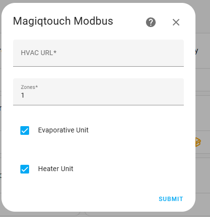
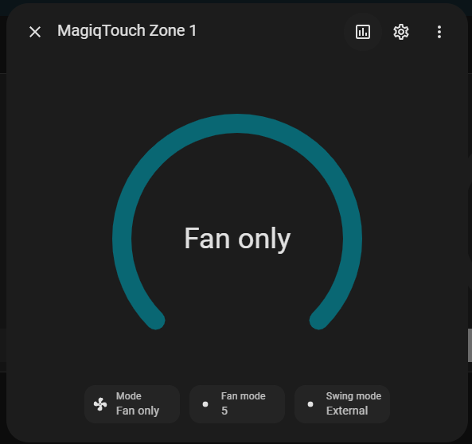
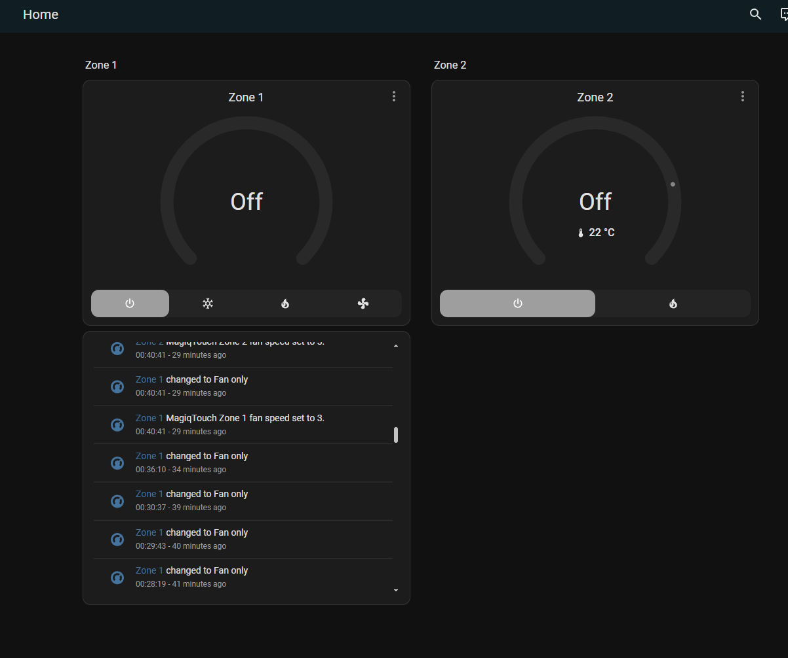

# Home Assistant Integration for the MagiqTouch Modbus ESP32 Interface

## Hardware Requirements
ESP Modbus Interface: https://github.com/mrhteriyaki/magiqtouch-modbus-esp32

## Installation
Add this repo to HACS: https://github.com/mrhteriyaki/magiqtouch-modbus-esp32-ha
Or manual install by copying custom_components folder.

## Configuration:

  

1. Set the URL of the HVAC ESP32 Module eg: http://192.168.20.112  
2. Set your zone count (1 or 2).  
3. Tick Evap / Heater modules for your supported setup.  

The settings can be changed later with Reconfigure on the integration entry, eg: if the module's IP address changes.

## Zones:

Zone 1 controls the whole system: power, mode (Fan / Cooler / Heater) and fan speed.  
In Heater mode, the Swing option opens / closes the Zone 1 heater tube. In Fan mode (with both Evap and Heater units), Swing selects External / Recycle.

Zone 2 is a heater zone, its On / Off opens / closes the Zone 2 heater tube.  
Selecting Heat on Zone 2 while the system is off or in another mode switches the whole system to Heater mode.

Dashboard display:  

Details showing fan speed selection and option to use temperature mode:  
  

Dashboard with Logbook:

