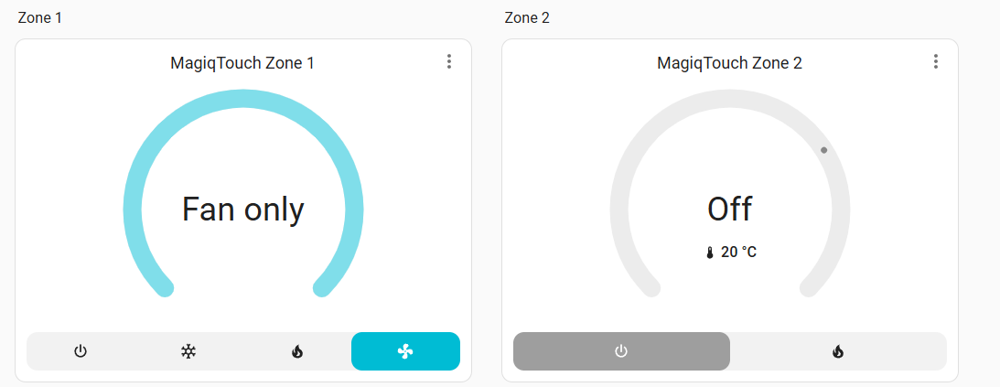
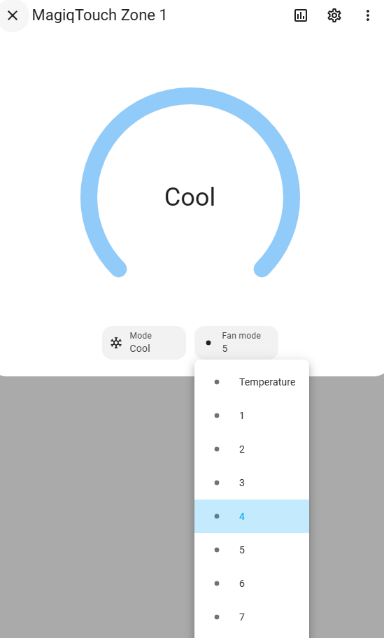

# MagiqTouch Modbus for Home Assistant

A Home Assistant integration for controlling a MagiqTouch HVAC system through the [MagiqTouch Modbus ESP32 interface](https://github.com/mrhteriyaki/magiqtouch-modbus-esp32).

## Requirements

- The [MagiqTouch Modbus ESP32 interface](https://github.com/mrhteriyaki/magiqtouch-modbus-esp32), connected to your HVAC system and reachable on your network.

## Installation

**HACS (recommended)**
Add `https://github.com/mrhteriyaki/magiqtouch-modbus-esp32-ha` to HACS as a custom repository, then install **MagiqTouch ModBus**.

**Manual**
Copy the `custom_components/magiqtouch_modbus` folder into your Home Assistant `config/custom_components` directory, then restart Home Assistant.

## Configuration

Add the integration from **Settings → Devices & Services → Add Integration**, then fill in:

| Setting | Description |
| --- | --- |
| URL | Address of the ESP32 module, e.g. `http://192.168.20.112` |
| Zones | Number of zones, 1 or 2 |
| Evap / Heater | Tick the units installed in your system (at least one) |

To change these later (e.g. if the module's IP address changes), use **Reconfigure** on the integration entry.

## Zones

**Zone 1** controls the whole system: power, mode (Fan / Cooler / Heater) and fan speed.
- **Heater mode:** the Swing option opens or closes the Zone 1 heater tube.
- **Fan mode** (with both Evap and Heater units): Swing selects External or Recycle air.

**Zone 2** is a heater-only zone. Turning it on or off opens or closes the Zone 2 heater tube. Turning it on while the system is off or in another mode switches the whole system to Heater mode.

## Screenshots

Fan speed selection and temperature mode:

Fan speed changes are recorded in the logbook:

